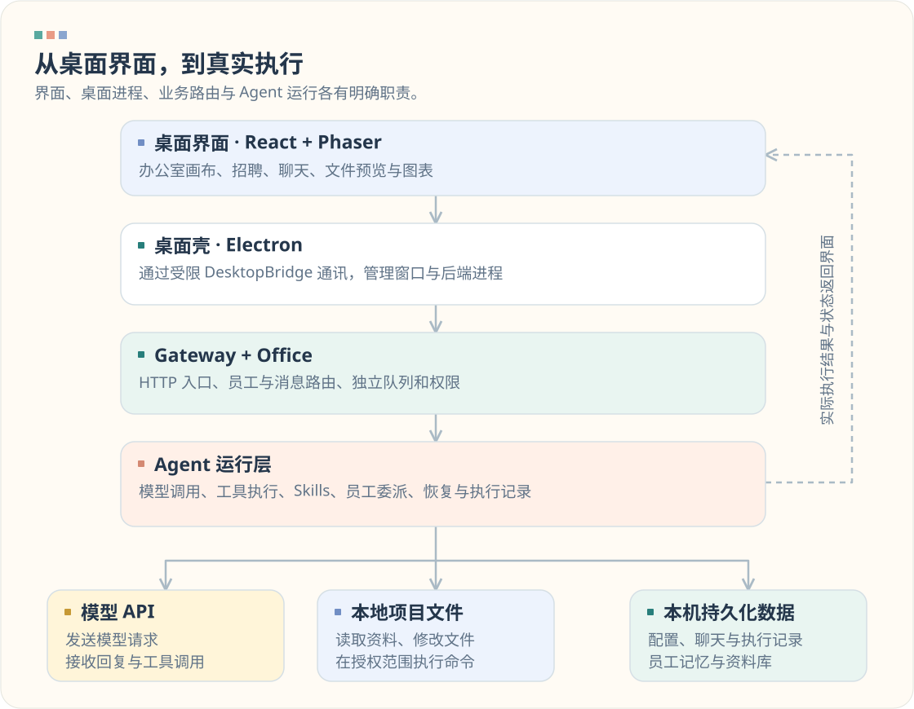
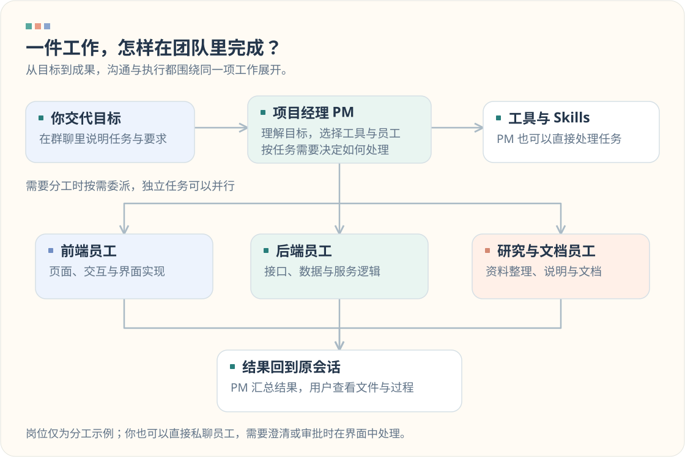
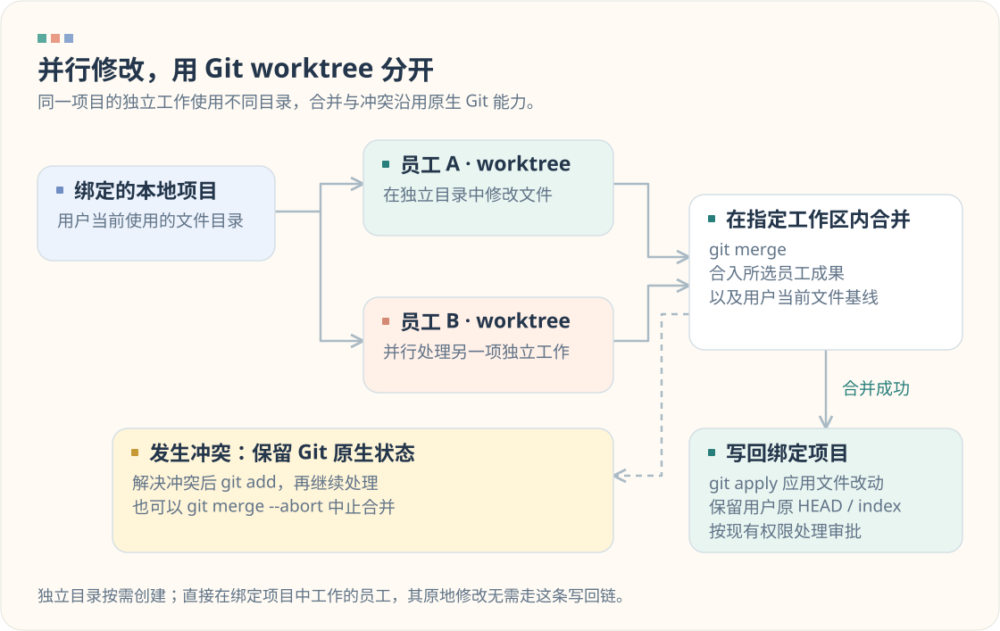

# 小小办公室多 Agent 架构

本文只描述当前仓库中的真实模块、调用链和边界。它不是功能完成证明；验证结论必须来自当前代码和本轮执行结果。

## 1. 系统边界

React 与 Phaser 展示办公室和工作过程，Electron 管理桌面窗口与后端进程。Gateway 和 Office 处理员工、消息、队列及权限，Agent 运行层连接模型与工具，执行结果和状态再返回界面。

<p align="center">
  
</p>

当前没有第二套 Agent 执行服务。Office API 与 Agent 运行层 RunManager 位于同一个 Gateway 进程内。

## 2. 桌面与客户端

`desktop/preload.cjs` 是渲染进程唯一桌面能力入口。桥接方法使用静态白名单，覆盖 Gateway 状态、项目绑定、员工管理、聊天、队列、Run 查询/取消/恢复和缩放；它不暴露通用 HTTP 调用。

事件只有：

- `service.status`
- `workspace.updated`

`client/src` 当前负责 Phaser 办公室画布、员工管理、群聊/私聊、队列、Run 过程、Gateway Badge、项目面板、缩放控制和 Toast。聊天只消费公共群聊或 Agent 运行层 Checkpoint，过程只消费指定 Run Event。

## 3. Gateway

`backend/app/gateway/app.py` 注册当前产品 API：

- `/api/office/*`
- `/api/models*`
- `/api/skills*`
- `/api/mcp/*`
- `/api/memory*`
- `/api/scheduled-tasks*`
- `/api/input-polish`
- `/api/v1/auth/*`
- `/health`

Office Router 只负责 HTTP 参数、依赖注入和错误映射。员工、项目、消息路由、FIFO、Run 启动/查询和展示投影位于 `deerflow.office`。

模型管理由 `OfficeModelService` 复用 Agent 运行层模型工厂提供，不另建模型执行层。`GET/POST /api/office/models` 查询和添加当前用户注册的模型，`PUT /api/office/models/default` 只更改默认引用。连接配置与按用户隔离的注册元数据共存于 `config.yaml`；办公室名称单独保存。新增模型先完成无项目副作用的工具往返验证再写入，加载失败回滚配置，返回结果不携带密钥。

新建员工时复制办公室全局默认到员工模型绑定，`resolve_employee_model` 只读取已保存的绑定。旧版未独立绑定的员工在启动迁移时固定为当时有效的模型，已有独立绑定保留。员工空闲时可在个人配置中选择当前办公室已注册模型，与姓名、Prompt、Skills 一起保存，保存失败一起回滚。启动 Run 时保存具体模型 ID；ask 恢复按原合同模型重新核对工具可用性。PM 创建新委派时获取最新模型目录，员工使用自己的有效模型，父 Run 继续原模型。默认切换不修改已有员工绑定或模型配置，不改写运行中合同，也不改变 Skills、权限、任务目录或 FIFO 的职责。

## 4. Office 领域层

### 4.1 项目

`OfficeProjectService` 保存一个经过规范化的项目绑定，并提供项目摘要、上下文、受限文件读取和搜索。运行时项目上下文必须同时携带匹配的 `office_project_id` 与 `office_project_path`。

### 4.2 员工

`OfficeEmployeeService` 维护员工配置和运行投影。员工投影状态只有：

- `idle`
- `working`
- `disabled`

员工配置、Skill、工具清单、个人信息和能力画像由 Office 服务维护；运行时不会从客户端拼装另一套员工对象。每个员工目录中的 `tools.yaml` 是工具选择合同，工具目录 API 提供名称、描述、来源和可用性；Skill 的 `allowed-tools` 元数据不参与工具授权。

### 4.3 权限

Office 权限分为：

- 默认权限：不能委派；
- `can_delegate == true`：可以委派，但默认限制写文件、执行进程、部署、写数据库等高影响能力。

工具清单在 Agent 创建前由 `deerflow.office.tool_contract` 解析，`deerflow.office.authority` 继续作为服务端安全上限和执行上下文限制。权限检查属于当前安全边界，不是客户端展示逻辑。

### 4.4 能力与路由

`EmployeeCapabilityRegistry` 从员工当前配置、Skill、工具和有效运行合同生成能力索引。`CapabilityRoutingService` 根据请求中的明确能力约束计算候选员工和缺口，不读取已删除的历史成功计数。

能力查询不启动员工。PM 需要找人时使用 `search_employee_registry` 实时查询；已有明确分工和真实员工 ID 时直接通过原生 `task` 执行。`task.required_tools` 只检查本任务必要工具，现有 EmployeeRunGate 原子接单；忙碌直接返回原因，不加入 PM 委派队列。用户直接消息 FIFO 保持原逻辑；没有团队级 ready 审批。

PM 根据任务选择工具、Skills 和员工，需要分工时将具体工作交给合适的员工，再汇总到原会话。图中岗位只是分工示例，实际匹配依据员工的能力、工具与权限；用户也可以直接私聊员工。

<p align="center">
  
</p>

### 4.5 当前 PM Workflow 与项目知识

PM 的“任务计划”和“编辑文件”由配置页勾选、保存到 `tools.yaml` 后生效，不设 PM 身份专属的编辑/终端黑名单。`write_todos` 不是必备项，只有授权时装配 Todo 中间件，并进入运行工具审计；待办未完成不强制阻止正常结束。终端控制目前仅前端未勾选、禁用，这不是后端安全边界；运行时仍按实际工具清单、原工作区与审批规则执行。路由、委派、ask、读取与受限的 `capture_user_message` 保持原合同。

以下是当前代码事实，不是二期目标或运行验收结论：

- Lead Agent 装配不再读取旧阶段决定 PM 工具或强制 `PMResult` 返回；基础提示指导 PM 按目标组合授权工具、独立 Skills 与真实员工。Office PM 不使用通用子智能体类型或“至少两个任务才委派”的模板。原生委派共享池上限 5；每轮默认上限 5，单次 Run 累计默认及硬上限 20，可显式降低。限流中间件与实际 task 工具装配保持一致，不依赖旧开关决定 Office PM 是否限流；未接受的调用明确告知未启动，不虚报排队。
- 新消息、Run 投影与启动恢复不再装配 WorkflowController 或消费阶段结果。`workflow_service.py` 仅查询和退役历史记录，没有自动阶段接续；旧记录继续作为历史知识来源。
- 新派工通过 `office/delegation.py` 校验真实工作身份和 Checkpoint AI/tool call，经 `ExecutionReceiptStore` 原子领取后进入原有员工 FIFO 与 SubagentExecutor，不读取旧阶段任务。旧阶段控制器、执行器、回复协议和运行提示模块已删除，不另起 Agent Loop。
- 员工委派使用真实 Employee 配置与 Agent 运行层 `task` / `SubagentExecutor`。原生任务关联 PM 父 Run 和 task ID；内部后台执行后，`task` 仍等待结果返回 PM。`report_to_pm` 返回结构化上报内容后继续原生 loop，不直接终止；task 的完成文案表示执行已返回，不等同业务验收通过，也不追加通用强制核验指导。委派员工不是 RunManager 中独立可恢复的子 Run，普通员工直接对话仍有自己的 Run。
- Office PM、直接员工和委派员工共用 `OfficeRoundBudgetMiddleware`：一次模型请求及其普通工具调用共用 900 秒有效执行预算，下一次模型请求重新计时；不限制整个 Office 任务总时长。FIFO、ask、批准与 task 等待不消耗预算，并行普通执行按实际经过时间计入。轮次与已消耗时长随原 Checkpoint 保存，Resume 不清零；超时沿原取消收尾及 Run/Subagent 状态链结束，不建立第二个执行循环。非 Office 超时语义不变。
- Workflow 仅为历史记录；读取解析保留旧字段，明确退役只改变旧活动标记并保留原始来源，不提供创建、改写方案或阶段推进。Run、Thread、Checkpoint 和 FIFO 保持各自身份。任务执行结束不等于质量验证或交付通过；员工 `working/idle` 展示投影主要随真实运行生命周期更新。
- `run_launch.py` 将阶段无关的 `office_work` 身份与 `office_work_context` 背景写入可信 Run 启动合同，Resume 保留同一工作身份。`work_context.py` 组装任务与相关知识，允许没有需求/架构方案；新 task 直接使用 PM 本次委派文本，收据保存首次背景/配置来源；Resume 的同一次调用不能用新背景再次执行。完整会话与结果继续由原生 Thread/Checkpoint 保存。
- `project_knowledge_service.py` 接收独立事实来源，按用户和项目隔离，保留来源；未投影历史 Workflow 确认/验证事实通过 `workflow_knowledge.py` 接入。无阶段的用户原话入口已具备；原生 task 的真实成功工具观察已接入历史证据采集；员工只取得获准且与任务有关的上下文。项目历史验证不代表当前产物已经通过。
- PM、员工与嵌入式客户端共享 Skill 元数据目录渲染；初始注入获准名称、简述和路径，正文通过现有文件工具按需读取，不再装配 `describe_skill`。`skills/access.py` 在主 Agent 与委派员工路径收紧文件读取范围，保留原 Sandbox、用户隔离和禁用检查。工具合同独立控制模型可见工具与执行准入；新 PM 默认获得需求分析、架构设计、任务规划三个独立 Skill；已有 PM 的个人配置不在启动时重写。
- 委派员工最终工具集排除 ask/task，执行上下文仍由合同收窄并保留 `report_to_pm`；普通员工直接对话的 ask 不变。
- Office 主 Agent 使用紧凑的系统模板，非 Office 通用模板保持独立。Office 主 Agent 和委派员工通过工具副本精简部分本地工具说明，不改变参数、执行函数、工具授权或 MCP 描述。已读 Skill 的正文可复用，缺失、不完整或变化时补读。项目知识的模型视图不再注入 tool_verification 的原始 evidence，完整证据仍保存；事实摘要、来源、约束与冲突保留，不增加目标筛选或硬限额。员工记忆、Work Context、正常历史和 257000 压缩阈值不变；大结果外置与历史压缩继续使用原中间件。
- `execution_workspace.py` 沿用执行收据数据库保存稳定工作区和使用关系。普通 task 默认 `current`，私聊直接操作绑定项目；明确选择 `new/continue/fork` 才新建、复用或分叉 worktree，不按工具权限自动创建。路径从开始固定，Git 准备由实际工具在线程中完成，委派 claim 也移出事件循环。Run 返回不冻结，不要求读后版本收据，原项目 HEAD/index 不变。发布工具按员工工具合同装配，不随任务默认目录隐藏；绑定目录任务通过显式 target 选择已有独立工作区进行整合。终端列表沿原执行记录提供命令摘要、cwd 和预览端口，不维护额外 ready 状态；委派返回携带该任务实际预览执行引用。
- `publish_task_result(target?, source_workspace_ids?)` 保存正常员工修改，以原生 `git merge` 合入来源和用户当前文件基线，再通过不修改 index 的 `git apply` 写回绑定目录。与 `apply_patch`、终端共用执行环境解析，显式 target 可选择已有工作区，不改变默认环境、不按目录隐藏授权工具。冲突保留真实未合并索引及 `MERGE_HEAD`，由普通 Git 暂存、提交或中止，不造冲突提交、不扫描标记。临时 index 和内部来源引用保留用户未提交内容；用户 HEAD/index 不变。批准沿原入口，无备用覆盖路径。task 传递配对交付工具 artifact 的有界操作记录，不传播发布资格，也不在收尾扫描或提交工作区。
- `task` 使用 `workspace_mode/workspace_id`，删除 `dependency_refs` 及冻结成果资格判断。同一用户/项目可跨 Run、员工继续真实工作区，原失败/超时收据不改写。当前执行员工来自 runtime。多员工独立成果由 PM 协调合并，冲突在 worktree 解决后回写，不另造验收流程。
- Windows 进程树仍由 `sandbox/local/managed_command.py` 管理，四个 PowerShell 工具沿用原进程库、权限和 FIFO。`powershell_run/list(target="project")` 操作绑定目录，也可指定同用户/项目工作区 ID；本次选择不切换默认环境。临时命令按 Run/原生任务收尾，不停止其他使用者或保留的预览服务。旧 Office bash 拒绝执行，其他工具沿原 Authority/MCP 权限，不再套额外操作白名单。

PM 装配、派工准入和 Run 生命周期均已解除固定阶段控制。客户端通过群聊 `runTargets` 跟踪真实 Run，历史任务与验证记录保持只读。

## 5. Run 执行

员工 Run 通过以下窄模块接入 Agent 运行层：

1. `OfficeMessagePipeline` 解析正式投递、single-flight 和员工 FIFO；
2. `OfficeRunLauncher` 把员工、Thread、模型、项目和 lease 事实转换为 Agent 运行层 Run 输入；
3. `app.gateway.services.start_run` 与 `RunManager` 创建、恢复、取消和完成 Run；
4. Run executor 构建 Agent 运行层并执行；
5. Checkpointer 保存图状态，RunStore 保存生命周期，RunEventStore 保存运行事件；
6. `OfficeRunView` 只校验员工归属并查询 Agent 运行层 Run、Event 和 Thread 历史；
7. `OfficeRunProjection` 消费 Agent 运行层生命周期，投影员工状态和群聊最终回复，有效 ask 从当前所属 Checkpoint 建立员工等待原因；原生最终回答不再触发下一阶段。

PM 启动时记录普通员工的 ID、显示名和模型绑定，用于解析委派目标和准备 Run 的模型配置。员工查询和 `task` 准入负责核对当前能力、忙闲状态和权限。

中断后的用户回答仍经过同一个 `OfficeMessagePipeline` 和员工 FIFO。`OfficeRunLauncher` 复用源 Run 的 Thread、Checkpoint、模型、项目和启动合同，以 Agent 运行层原生 Resume 创建新 Run。问题匹配与过期校验基于当前 Checkpoint，旧阶段 revision 不再参与。等待原因与群聊手动暂停独立，Resume 首次 Checkpoint 持久化后才移除原问题等待原因。手动暂停/取消标记保存在既有 Run metadata.office_control，未新增控制 Store。

暂停继续与启动重建使用当前项目及最新 Checkpoint 的所属 Run 选择暂停记录，历史 paused 不再被误当成待恢复执行。暂停完成后仍允许新对话；新对话推进检查点后不会回退旧检查点。群聊中真实 @PM 前缀仅在识别“继续执行”等控制短语时去除，保存的原消息不改写。

共享 ToolErrorHandlingMiddleware 为解析失败的 invalid_tool_calls 生成对应调用 ID 的错误 ToolMessage，并接回原生 Agent 图让模型修正参数；不猜测 XML、不另建重试循环。混合合法调用仍执行一次，预算/安全终止先清除全部工具意图，不被恢复钩子重新打开。未处理的非法最终调用不能作为员工成功交付。

Run 状态词汇为：

- `pending`
- `running`
- `success`
- `error`
- `timeout`
- `interrupted`

文本写入使用 `apply_patch` → 当前绑定目录或明确选择的 worktree → 补丁上下文匹配与应用。删除 Office 操作标记和读后重读门禁；保留路径、Secret、编码/大小、取消安全及部分失败清单。非 Office 原读前写中间件不变，工具授权沿原 Authority/工具合同。

### 5.1 并行工作区与写回

需要隔离修改时，员工使用独立的 Git worktree。成果先在指定工作区中通过 `git merge` 合并，成功后再用 `git apply` 写回绑定项目，保留用户原有的 HEAD 和 index。冲突保留 Git 原生状态，解决后继续，也可以中止合并。直接在绑定目录中的修改无需额外写回。

<p align="center">
  
</p>

## 6. 运行参数边界

业务运行参数统一放在：

```python
config["context"]
```

`config["configurable"]` 只用于 LangGraph Checkpoint 身份：

- `thread_id`
- `checkpoint_id`
- `checkpoint_ns`
- `checkpoint_map`

认证用户、员工、模型、项目和 Office 权限由服务端写入受信任上下文。外部请求不能覆盖服务端字段。

## 7. Agent 运行能力

当前 Agent 运行层提供以下能力：

- Lead Agent 与 Middleware；
- 工具搜索、Skill、MCP；
- Sandbox 与虚拟路径；
- Memory；
- Subagent；
- Checkpointer、Store、RunManager、RunJournal；
- 模型与 Token 统计。

Office 层员工、项目、能力路由、权限、运行投影及历史 Workflow/项目知识接缝，不维护平行的 Agent 循环。

## 8. 数据与结果

- 项目文件来自当前项目绑定。
- 默认项目文件位于绑定目录；独立环境位于 `<绑定目录>/.office-worktrees/<workspace_id>/{tree,outputs}`。路径投影不创建目录，实际操作首次使用时准备。带 ID 的文件引用按 Run 的用户/项目解析，不要求 PM 自己有 worktree；文件不存在不转读其他目录同名文件。默认输出与上传沿原线程目录。
- `.office-worktrees` 通过 Git `info/exclude` 本地排除，同时从项目扫描、Git 快照和搜索中排除；不修改用户 `.gitignore`、HEAD 或暂存区。项目知识入库的冗余全树内容指纹计算已移除，不影响合并使用的 Git 快照。目录解析保持用户/项目归属与链接检查，具体 Run 仍受原入口授权；旧外部目录记录或丢失绑定明确失败，不回退到办公室仓库。
- 群聊用户原文与最终回复保存在用户隔离的 SQLite；私聊与员工 Thread 历史读取 Agent 运行层 Checkpoint。
- 工具、制品、Subagent 和终态过程按员工 Run 从 RunEventStore 增量读取；Office 不提供跨 Run 工件或事件聚合接口。
- 公开过程正文复用主 Agent 响应和带服务端员工/任务身份的 `subagent.step`，每轮正文生成后增量展示，不是逐 Token 输出。委派员工显示小头像与姓名，PM 主头像和工具展示不变；隐藏、摘要、推理块及工具输出不作为正文。Run/任务/员工/消息身份用于历史去重与排序，不生成新的聊天消息或模型上下文副本；正文中的“完成”不代替 Run 收尾事实。
- 数据库、Run 事件、Checkpoint 与 Memory 使用 `config.yaml` 中的当前配置。
- 自动记忆开启且采用 middleware 模式时，原生 task 首次记录委派终态后，将任务及结果送入对应用户、员工的现有 Memory 更新队列；以委派身份区分更新来源，避免同一父 Thread 内多次派工被防抖覆盖，回放收据不重复入队。工具操作摘要与员工自述分开，失败或中断不代表没有部分写入。记忆提炼仍是异步、尽力而为，失败记录日志且不改变执行结果；群聊和私聊沿用员工个人记忆注入。
- 历史 Workflow、项目知识与委派收据分别保存在用户范围的 `office-workflows.v1.sqlite3`、`office-project-knowledge.v1.sqlite3` 和 `office-execution-receipts.v1.sqlite3`，不替代 Agent 运行层 RunStore、Checkpoint 或员工 Memory。
- `backend/.deer-flow/` 是本地运行数据，不是源代码。

## 9. 架构不变量

1. Office Router 不复制运行引擎。
2. 员工消息只能进入 `OfficeMessagePipeline -> OfficeRunLauncher -> start_run -> RunManager`。
3. 桌面 IPC 只承载静态白名单内的显式业务方法，不成为通用后端代理。
4. 聊天、队列和 Run 过程只投影后端事实，不在客户端建立第二份事实源。
5. 运行领域参数只进入 `context`；Checkpoint 身份只进入 `configurable`。
6. 员工权限、用户身份和项目绑定由服务端建立。
7. 当前数据形状只有一套；删除的定义、配置和字段不保留读取分支。
8. 文档只描述当前代码，不把计划写成已实现事实。

## 10. 当前接缝

桌面已显式接入员工、聊天、队列和 Run 投影。新增能力仍必须逐项加入 DesktopBridge 静态白名单，并用 Gateway 与 Electron 验证；不得把 preload 扩张成通用后端代理。

## 来源

小小办公室基于 [DeerFlow](https://github.com/bytedance/deer-flow) 二次开发，保留其 [MIT 许可](backend/DEERFLOW_LICENSE)。
