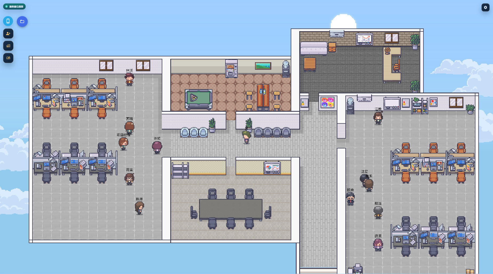
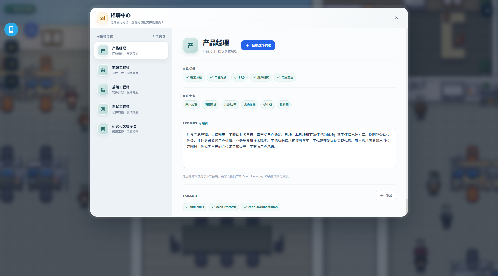
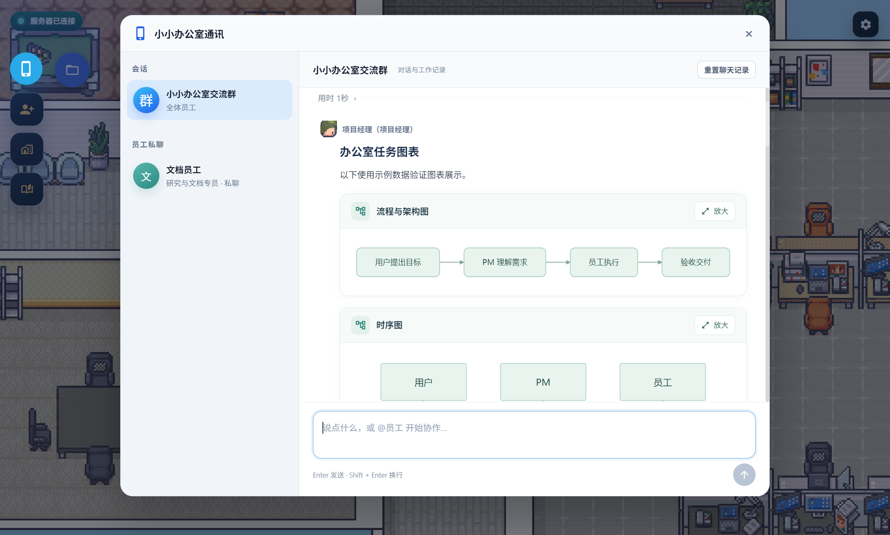
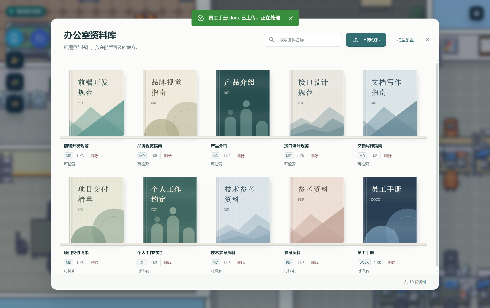

<div align="center">


# Small Office · 小小办公室

**Bring your AI team into one small office.**

A pixel office running on your computer. Hire AI employees, connect your own models,<br>
and give the project manager a goal. Follow the work and review the results in one window.

**Windows x64 · English / 简体中文 · MIT**

[About](#about) · [Build your team](#team) · [Get started](#quick-start) · [Models](#models) · [Development](#development)

[Contributing](CONTRIBUTING.md) · [MIT License](LICENSE) · [Security](SECURITY.md) · [Known limitations](#known-limitations)

**English | [简体中文](README.zh-CN.md)**

</div>

<p align="center">
  
</p>

<p align="center"><sub>A little more life in your working day. Screenshots show the Chinese interface.</sub></p>

---

<a id="about"></a>

## What is Small Office?

Working on your own can still mean working with a team.

Small Office brings employees, models, chat, files, and execution records into a desktop application. Talk directly to an employee about a specific task, or give the project manager (PM) a goal and let it choose tools and teammates, coordinate the work, and bring the results back.

The pixel office makes the team visible: employees have names, desks, and room to move around. Their work connects to a local project folder, where they can read reference material, edit files, and run commands.

**Use it for:** building small projects together, organizing documents and research, and handling work with clear inputs and expected outputs.

<a id="team"></a>

## Build your AI team

*Find the right teammates, then give them something to work on.*

<p align="center">
  
</p>

- **Start with a role template.** Give employees names and adjust their instructions and Skills.
- **Choose a model for each employee.** The PM and regular employees can use different models. Changing the global default keeps existing employee bindings intact.
- **Set tools and permissions.** Configure what each employee can use, with authorization enforced separately from their work instructions.
- **See your team in the office.** Employees have their own workstations and status. When idle, they move around, pause, and interact.

## Hand off the work

*Describe the goal in group chat, or talk directly to an employee.*

**Not sure which employee to choose?** Give the task to the PM. It identifies the capabilities your request needs, selects the most suitable employees, and divides the work. **Assignments are driven by capabilities rather than job titles.**

**No suitable employee?** The PM holds back the assignment and reports the capability gap to you.

<p align="center">
  
</p>

- **Group collaboration.** The PM can select tools, use Skills, and delegate specific tasks to employees.
- **Direct conversations.** Talk to an employee about its work. Messages sent while it is busy enter that employee's own queue.
- **Your local project.** Bind a working folder so employees can work on real files.
- **Parallel work when needed.** Git worktrees isolate changes, with native Git conflict handling for collaborative development.

For example, ask the PM in group chat:

> Build an introduction page for this project. Inspect the existing structure first, then arrange the frontend implementation and documentation. When finished, tell me which files changed, how to run it, and what you verified.

## Follow the process and inspect the results

*See who is doing what, and continue the conversation when something needs your input.*

<p align="center">
  
</p>

- **Execution records.** View public replies, tool operations, command status, and results in the conversation.
- **Questions and approvals.** Answer clarification requests in chat and decide execution approvals in the interface.
- **Pause and resume.** Follow the PM's group execution or stop a regular employee's current execution.
- **File previews.** Inspect code, Markdown, and images, with an option to locate the file.
- **Visual explanations.** Display flowcharts, sequence diagrams, and bar, line, and pie charts.

## Keep shared references close

*Put specifications, notes, and reference documents on one bookshelf.*

<p align="center">
  
</p>

Upload TXT, Markdown, PDF, or DOCX files to search, read, and manage them in the library. Employees can retrieve relevant passages for their tasks and cite the source document and location in their answers.

Embedding and reranking models are configured separately from chat models. The library processes text; PDFs need a text layer, and images are not processed with OCR.

<a id="quick-start"></a>

## Get started

Small Office runs on **Windows x64**. Clone the repository and follow the [source setup instructions](#development), then use the steps below to start your first task.

### Start your first task in four steps

1. **Create your office.** Select a working folder and name the office. Choose English or Simplified Chinese for the interface.
2. **Connect a model.** Enter the model name, API endpoint, and your own API key, then pass the connection test.
3. **Hire employees.** Select templates for your tasks and adjust models, instructions, Skills, and tools as needed.
4. **Give the team a goal.** Open chat and ask the PM in the group, or choose an employee for a direct conversation. Follow the execution and inspect the results.

Office configuration, conversation history, and library data are stored locally. When you use cloud chat, embedding, or reranking services, the relevant conversation and text are sent to the model services you configure.

<a id="models"></a>

## Connect your own models

Models connect through APIs. After initial setup, add and edit models in office settings, choose a global default, and assign models to individual employees.

| Model service | Model service |
| --- | --- |
| OpenAI | DeepSeek |
| MiMo | Kimi |
| GLM | Doubao |
| MiniMax | |

Model names and API endpoints are configurable. Your chosen model needs to support the tool calls required by the task. Select image input and reasoning settings according to the model's actual capabilities.

The interface supports **English and Simplified Chinese**. Switching languages updates the interface while keeping existing employees, conversations, and files in their original language.

<a id="development"></a>

## Run from source

Use the pinned toolchain and the repository's lockfiles.

| Tool | Version |
| --- | --- |
| Node.js | 24.22.2 |
| npm | 11.19.1 |
| Python | 3.12.13 |
| uv | 0.11.28 |

Open PowerShell at the repository root. For a first-time setup, run:

```powershell
npm ci
npm --prefix client ci
uv sync --directory backend --locked

# Copy the key-free defaults before the first launch.
# If config.yaml already exists, keep it and skip this line.
Copy-Item desktop/packaging/defaults/config.yaml config.yaml

npm run runtime:powershell
npm run dev:check
npm run dev
```

Configure your own model in the setup screen. Installing dependencies and preparing runtimes requires an internet connection.

Useful development commands:

| Purpose | Command |
| --- | --- |
| Build the client | `npm run build` |
| Check translation resources | `npm --prefix client run check:i18n` |
| Verify bilingual desktop flows | `npm run test:i18n` |
| Verify desktop boundaries and rendering | `npm run test:minimum` |

The [Windows CI workflow](.github/workflows/ci.yml) runs the existing checks with local model fixtures. See [Contributing](CONTRIBUTING.md) for the validation commands and [Development and maintenance (Chinese)](docs/development.zh-CN.md) for detailed startup, packaging, and troubleshooting instructions.

## Known limitations

- **Windows x64 only.**
- **Windows installer.** This release is source-only. The existing installer is about 463 MB, is unsigned, and uses the default Electron icon. SmartScreen may block it.
- **Local, single-user Gateway.** The desktop app disables Gateway authentication by default (`DEER_FLOW_AUTH_DISABLED=1`). Keep the Gateway on localhost and never expose it to the public internet.
- **Model costs.** The default configuration sets `subagents.token_budget.enabled=false`. Long tasks with expensive models have no built-in spending cutoff.
- **No OS-level sandbox.** Git worktrees separate parallel changes and approvals gate certain actions. Commands still run with the local user's OS permissions.

## Architecture

```text
               Desktop (Electron renderer)
                   React + Phaser UI
                        |
                 DesktopBridge (IPC)
                        v
            +------------------------+
            |     Electron main      |
            |    Window + Gateway    |
            +-----------+------------+
                        | HTTP / 127.0.0.1
                        v
            +------------------------+          +------------------------+
            |    FastAPI + Office    | -------> |    SQLite + LanceDB    |
            +-----------+------------+          +------------------------+
                        |
                        v
            +------------------------+          +------------------------+
            |     Agent Runtime      | -------> |       Model APIs       |
            | LangChain + LangGraph  |          +------------------------+
            +-----------+------------+
                        |
                        v
              Tools / Skills / Employees
                        |
                        v
         Local files / PowerShell / Git worktree
```

| Layer | Stack |
| --- | --- |
| Interface | React, TypeScript, and a Phaser pixel office |
| Desktop | Electron with restricted IPC and DesktopBridge |
| Backend | Python, FastAPI Gateway, and Office domain services |
| Agent execution | LangChain and LangGraph; model calls, tools, Skills, and employee delegation |
| Data | SQLite; LanceDB for the library's vector index |
| Local execution | PowerShell; Git worktrees for parallel changes, native Git merges and writeback |

## Documentation

| Looking for | Start here |
| --- | --- |
| Setup, builds, and verification | [Development and maintenance (Chinese)](docs/development.zh-CN.md) |
| Making a contribution | [Contributing](CONTRIBUTING.md) |
| Domain terminology | [Domain glossary (Chinese)](CONTEXT.md) |
| Architecture and module boundaries | [Architecture guide (Chinese)](ARCHITECTURE.md) |

## Maintenance and updates

I maintain this project as an **individual contributor** and will continue updating and improving it.

## License and acknowledgments

Small Office's own code and character artwork use the [MIT License](LICENSE). Third-party licenses and existing attribution are retained.

The office map and Phaser visualization are adapted from [SkyOffice](https://github.com/kevinshen56714/SkyOffice). Small Office is developed as a derivative of [DeerFlow](https://github.com/bytedance/deer-flow), whose [MIT license](backend/DEERFLOW_LICENSE) is included. Thank you to both projects.
