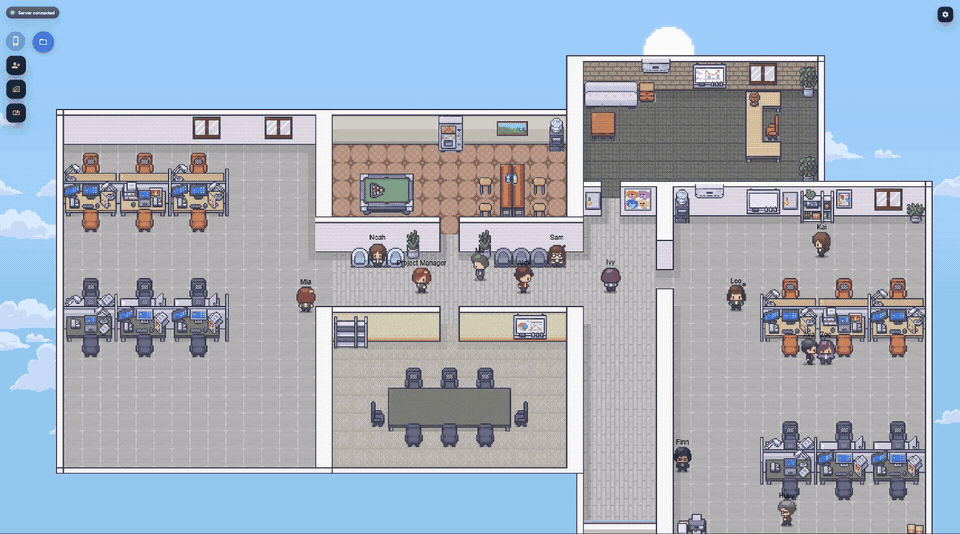
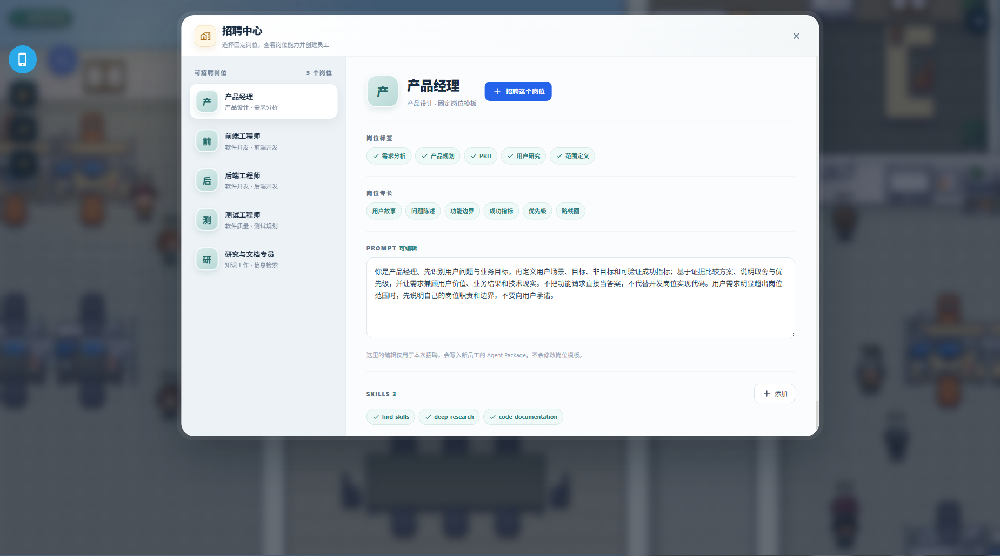
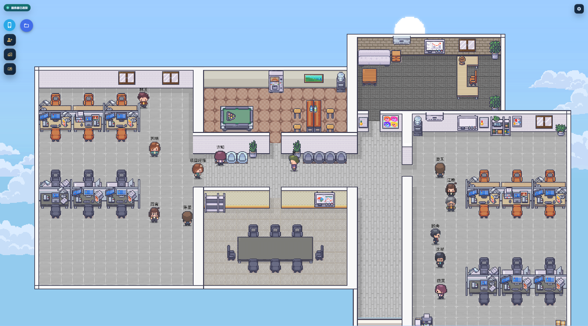
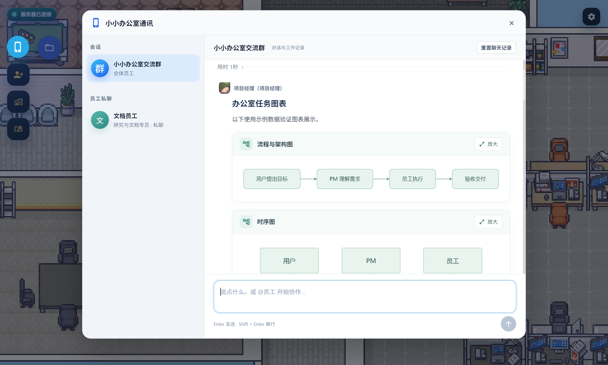
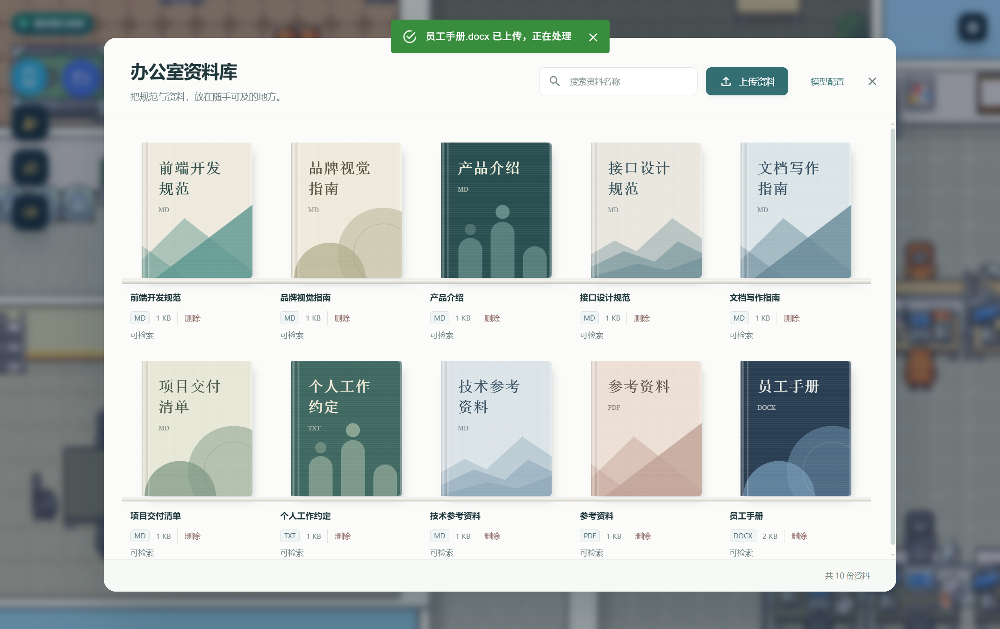

<div align="center">


# 小小办公室 · Small Office

**把 AI 员工，带进你的办公室。**

一间运行在你电脑上的像素办公室。招聘 AI 员工、接入自己的模型，<br>
在群聊里交代目标，让项目经理协调分工，在同一个窗口里跟进过程和查看成果。

**Windows x64 · macOS 15+（Apple Silicon）· English / 简体中文 · MIT**

[认识办公室](#about) · [组建团队](#team) · [开始使用](#quick-start) · [模型接入](#models) · [开发与文档](#development)

[贡献说明](CONTRIBUTING.md) · [MIT 许可](LICENSE) · [安全政策](SECURITY.md) · [已知限制](#已知限制)

**[English](README.md) | 简体中文**

</div>

<p align="center">
  
</p>

<p align="center"><sub>工作之外，也让办公室热闹一点。</sub></p>

<p align="center">
  <a href="docs/assets/media/small-office-tour-en.mp4">观看 65 秒英文演示</a> ·
  <a href="docs/assets/media/office-en.png">查看静态截图</a>
</p>

<p align="center"><sub>PM 搜索 GitHub，委派文档专员，交付带来源链接的文档。真实模型执行，剪辑缩短了等待时间。</sub></p>

---

<a id="about"></a>

## 小小办公室是什么？

一个人做项目，也可以有一支分工明确的 AI 团队。

小小办公室把员工、模型、聊天、文件和执行过程放进一个桌面应用。你可以直接找某位员工处理具体问题，也可以把目标交给项目经理（PM），由它选择工具和员工协作，再汇总结果。

像素场景是这支团队的可视化入口：员工有名字、有工位，也会在办公室里走动。实际工作连接本地项目目录，可以读取资料、修改文件和执行命令。

**适合用来：** 协作开发一个小项目、整理文档与研究资料、处理有明确输入和交付要求的工作。

<a id="team"></a>

## 组建你的 AI 团队

*先招到合适的伙伴，再把事情交给他们。*

<p align="center">
  
</p>

- **按岗位招聘。** 从内置岗位模板开始，为员工起名字，调整工作说明和 Skills。
- **为员工分配模型。** PM 和普通员工可以使用不同模型；修改全局默认模型不会覆盖已有员工的绑定。
- **选择工具与权限。** 按员工配置可用工具，让工作方法和实际授权各有明确边界。
- **看得见的办公室。** 员工进入像素场景，拥有各自的工位和状态；空闲时会走动、停留和互动。

## 把工作交出去

*在群聊里说清目标，也可以直接找某位员工。*

**不知道选哪个员工？** 直接交给项目经理，他会根据你的需求自动识别需要的员工，由他进行分工，自己选择最合适的员工。**不是按岗位驱动而是按照能力驱动。**

**没有合适的员工？** 不用担心，项目经理会自己拦截任务并向您汇报能力缺口。

<p align="center">
  
</p>

- **群聊协作。** 向 PM 说明目标，它可以选择工具、调用 Skills，或把具体任务委派给员工。
- **员工私聊。** 直接讨论某项工作；员工忙碌时，后续消息进入它自己的队列。
- **连接本地项目。** 绑定工作目录，让员工围绕真实文件工作。
- **按需并行。**  Git worktree 隔离修改，冲突处理协作开发。

例如，可以在群聊里向 PM 提出：

> 帮我给当前项目做一个介绍页面。先查看现有结构，再安排前端实现和文档说明；完成后告诉我改了哪些文件、怎么启动、做过哪些验证。

## 跟得上过程，也看得懂结果

*知道谁在做什么，遇到问题就在原会话里继续。*

<p align="center">
  
</p>

- **执行记录。** 在会话中查看公开回复、工具操作、命令状态和执行结果。
- **澄清与审批。** 员工需要补充信息时，在聊天框回答；需要执行审批时，在界面中决定。
- **暂停与继续。** 跟进 PM 的群聊执行，也可以停止普通员工当前的执行。
- **文件预览。** 直接查看代码、Markdown 和图片，保留文件定位入口。
- **图表表达。** 支持流程图、时序图，以及柱状图、折线图和饼图。

## 给团队一个随手可查的资料库

*规范、说明和参考资料，放到同一个书架上。*

<p align="center">
  
</p>

上传 TXT、Markdown、PDF 或 DOCX 后，可以在书架中搜索、阅读和管理。员工可按任务检索资料，并在回答中引用对应文档及位置。

资料库的向量模型和精排模型单独配置。当前处理文本内容，PDF 需要文字层，图片内容不做 OCR。

<a id="quick-start"></a>

## 开始使用

小小办公室支持 **Windows x64** 和 **macOS 15+ 的 Apple Silicon（arm64）设备**。克隆仓库后，按[源码启动步骤](#development)完成环境准备，再开始第一项工作。

### 四步开始第一项工作

1. **创建办公室。** 选择工作目录，填写办公室名称；界面可以切换为 English 或简体中文。
2. **接入模型。** 填写模型名称、API 地址和自己的 API Key，通过连接测试后进入办公室。
3. **招聘员工。** 根据任务选择岗位，按需调整员工的模型、工作说明、Skills 和工具。
4. **交代目标。** 打开通讯，在群聊中向 PM 说明需求，或选择员工私聊，跟进执行与成果。

办公室配置、聊天记录和资料库保存在本机。调用云端聊天、向量或精排服务时，相应的对话和文本会发送给你配置的模型服务。

<a id="models"></a>

## 接入你自己的模型

通过模型 API 接入。首次初始化后，可以在办公室设置中添加、编辑模型并设置全局默认，再为员工分别选择模型。

| 模型服务 | 模型服务 |
| --- | --- |
| OpenAI | DeepSeek |
| MiMo | Kimi |
| GLM | 豆包 |
| MiniMax | |

模型名称和 API 地址可以自行填写。具体型号需要支持当前任务使用的工具调用；图片输入和思考配置按实际模型能力选择。

界面支持 **English / 简体中文**。切换语言会更新界面，不改写已有员工、对话或文件内容。

<a id="development"></a>

## 从源码运行

当前锁定环境如下，依赖安装使用仓库中的锁文件。

| 工具 | 版本 |
| --- | --- |
| Node.js | 24.22.2 |
| npm | 11.19.1 |
| Python | 3.12.13 |
| uv | 0.11.28 |

在 **Windows x64** 上，于仓库根目录打开 PowerShell，首次准备时执行：

```powershell
npm ci
npm --prefix client ci
uv sync --directory backend --locked

# 首次启动前，复制无密钥配置模板。
# 已有 config.yaml 时保留自己的配置，跳过这一行。
Copy-Item desktop/packaging/defaults/config.yaml config.yaml

npm run runtime:powershell
npm run dev:check
npm run dev
```

在 **macOS 15+ 的 Apple Silicon 设备**上，于仓库根目录打开终端，使用原生 arm64 的 Node.js 和 Python：

```bash
npm ci
npm --prefix client ci
uv sync --directory backend --locked

# 首次启动前，复制无密钥配置模板。
# 已有 config.yaml 时保留自己的配置，跳过这一行。
cp -n desktop/packaging/defaults/config.yaml config.yaml

npm run runtime:prepare
npm run dev:check
npm run dev
```

Mac 环境准备会下载自带的 Node.js、Git 和 PowerShell。两种平台的员工终端均使用 PowerShell 7。项目位于桌面、文稿、下载或外接磁盘时，请在 macOS 弹窗中允许应用访问所选目录。

启动后，在初始化界面配置自己的模型。准备依赖和运行时需要联网。

常用开发入口：

| 目的 | 命令 |
| --- | --- |
| 构建客户端 | `npm run build` |
| 检查语言资源 | `npm --prefix client run check:i18n` |
| 验证双语桌面流程 | `npm run test:i18n` |
| 验证桌面基本边界与渲染 | `npm run test:minimum` |
| 在 Apple Silicon Mac 上构建本地 DMG | `npm run package:mac` |

完整的启动、打包、验证和排查说明见 [运行与维护说明](docs/development.zh-CN.md)。

自动检查见 [Windows CI](.github/workflows/ci.yml)，贡献与验证方式见 [贡献说明](CONTRIBUTING.md)。CI 使用隔离数据和本地受控模型；macOS 检查在 Apple Silicon Mac 上本地执行。

## 已知限制

- **平台范围。** 支持 Windows x64 和 macOS 15+ 的 Apple Silicon（arm64）设备，暂不支持 Intel Mac 和 Linux。
- **Windows 安装包。** 本次只发布源码。已有安装包约 463 MB，**未签名**，使用默认 Electron 图标。运行时可能被 SmartScreen 拦截。
- **macOS 安装包。** `npm run package:mac` 生成采用 ad-hoc 签名、未经公证的本地测试 DMG。正式分发使用 `npm run package:mac:release`，需要在 Mac 上配置 Developer ID 签名与 Apple 公证凭据。本地测试包可能被 Gatekeeper 拦截。
- **本地单用户 Gateway。** 桌面启动时默认免鉴权（`DEER_FLOW_AUTH_DISABLED=1`）。请只在本机访问 Gateway，切勿暴露到公网。
- **模型费用。** 默认配置为 `subagents.token_budget.enabled=false`。用高价模型跑长任务时，没有内置的费用熔断。
- **无 OS 级沙箱。** Git worktree 分隔并行文件修改，审批控制特定操作。命令仍以本机用户的操作系统权限执行。

## 架构

```text
               Desktop (Electron renderer)
                   React + Phaser UI
                        |
                 DesktopBridge (IPC)
                        v
            +------------------------+
            |     Electron main      |
            |    Window + Gateway    |
            +-----------+------------+
                        | HTTP / 127.0.0.1
                        v
            +------------------------+          +------------------------+
            |    FastAPI + Office    | -------> |    SQLite + LanceDB    |
            +-----------+------------+          +------------------------+
                        |
                        v
            +------------------------+          +------------------------+
            |     Agent Runtime      | -------> |       Model APIs       |
            | LangChain + LangGraph  |          +------------------------+
            +-----------+------------+
                        |
                        v
              Tools / Skills / Employees
                        |
                        v
         Local files / PowerShell / Git worktree
```

| 层 | 技术栈 |
| --- | --- |
| 界面 | React、TypeScript、Phaser 像素办公室 |
| 桌面 | Electron，受限 IPC 与 DesktopBridge |
| 后端 | Python、FastAPI Gateway、Office 领域服务 |
| Agent 执行 | LangChain、LangGraph，模型调用、工具、Skills 与员工委派 |
| 数据 | SQLite；资料库使用 LanceDB 保存向量索引 |
| 本地执行 | PowerShell；Git worktree 隔离并行修改，原生 Git 处理合并与写回 |

## 文档

| 想了解什么 | 从这里看 |
| --- | --- |
| 启动、构建与验证入口 | [运行与维护说明](docs/development.zh-CN.md) |
| 参与贡献 | [贡献说明](CONTRIBUTING.md) |
| 项目里的领域名称 | [领域词汇](CONTEXT.md) |
| 当前架构和模块边界 | [架构说明](ARCHITECTURE.md) |

## 维护与更新

本项目由我作为**个人贡献者**维护，后续会持续更新和完善。

## 开源与致谢

小小办公室的自有代码与角色素材采用 [MIT License](LICENSE)，保留第三方许可证和已有署名。

办公室地图与 Phaser 可视化基于 [SkyOffice](https://github.com/kevinshen56714/SkyOffice) 修改。

小小办公室以 [DeerFlow](https://github.com/bytedance/deer-flow) 作为 Agent 运行底座，在其之上进行了大量二次开发，包括本地桌面应用与像素办公室、员工管理与能力驱动的任务委派、Git worktree 并行协作与成果写回、执行审批、办公室资料库、中英文界面，以及 Windows/macOS 平台适配。项目保留 DeerFlow 的 [MIT 许可](backend/DEERFLOW_LICENSE)及上游署名。感谢两个开源项目。
