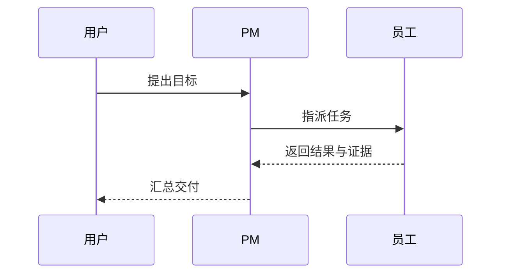

# 对话图表

图能明显帮助理解或用户明确要求时再绘制；简单问题用文字回答。图前后简短说明要表达的关系或结论。
直接在回复或 Markdown 文档中输出下列代码块，不需要新增工具调用、Bash、外部服务或 HTML。
已有工具仍用于读取真实文件、查证来源；本 Skill 不授予工具权限。

## 流程与关系

用 `mermaid` 围栏。支持 `flowchart` / `graph` 流程与架构图，以及 `sequenceDiagram` 时序图。
架构图使用流程图的节点、子图和连线表达。节点 ID 用简短英文，中文标签加双引号；节点过多时按主题拆图。
使用纯文本标签；不加 HTML、图片、链接、click、style、classDef、linkStyle、初始化指令或 YAML 配置。颜色和排版由客户端统一处理。




## 数据图表

使用 `office-chart` 围栏，内容必须是合法 JSON。普通 `json` 围栏只展示源码。

- `type`：`bar`（分类比较）、`line`（有顺序的趋势）、`pie`（同一整体的占比）。
- `title`：清楚的标题，最多 120 字符。
- `labels`：1–40 个不重复的分类名称，每个最多 80 字符。
- `series`：1–6 组数据，每组只有 `name` 和 `values`。组名不重复；values 与 labels 逐项对应且数量相同。
- `unit`：可选，单位，最多 24 字符。所有数据组须使用相同单位。
- `source`：可选，简短来源说明，最多 200 字符。需要链接时在图外正常引用。

数值使用有限的 JSON 数字，绝对值不超过一万亿。更大的数值先换算单位并说明。
折线图用 `null` 表示缺失数据，至少保留一个真实数值；不要用零替代缺失数据。
饼图只支持一组非负数据，至少一个值大于零；分类必须属于同一整体。
不传 ECharts 原始配置、回调函数、自定义样式或其他字段。

下面仅为格式示例，数据是假设数据，实际回答不能直接套用：

```office-chart
{
  "type": "bar",
  "title": "各模块已完成任务（示例）",
  "labels": ["前端", "后端", "测试"],
  "series": [{"name": "已完成", "values": [8, 6, 5]}],
  "unit": "项",
  "source": "假设数据，仅演示格式"
}
```

用户没提供且无法查证的数据，不编造；说明缺少什么信息。只有用户明确要示意数据时才可使用，并标注“假设/示例”。
单个图块控制在 12000 字符内；Mermaid 不超过 120 行、100 条连线。复杂信息拆分，不通过增大配置绕过限制。
格式错误会提示原因，按原因修正原代码块即可；不要声称生成了不存在的图片文件或下载地址。
